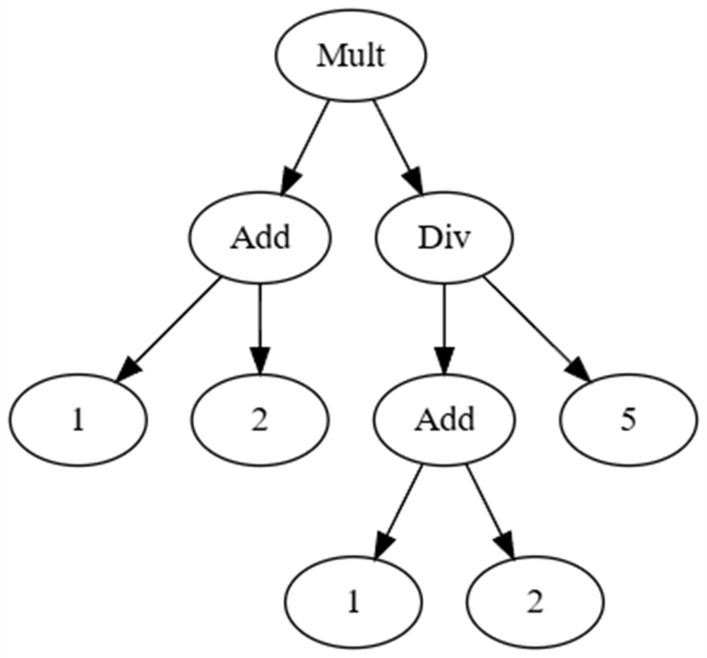
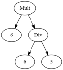
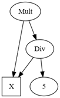
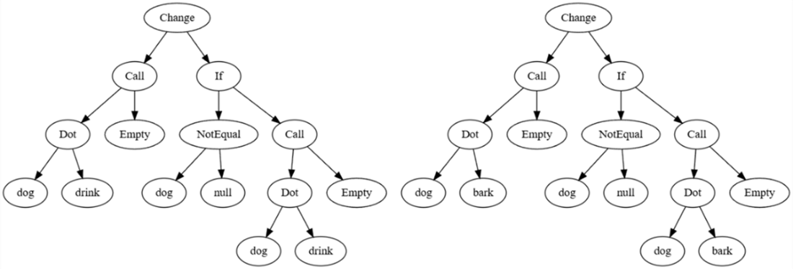

# 二元项的反统一

**本章内容包括**

- 使用“反统一”来寻找泛化
- 一个真实世界开发者辅助工具的雏形

第 10 章里我们学习了，“统一”从两个可能包含具名“占位符”的二元项出发，找出一个“置换”——也就是要填入这些占位符的一组值——使得把这个置换应用到两个项上后会产生相同的结果。那么，反统一到底是什么呢？

我喜欢把统一理解为从一般到具体：我们从可以容纳任何内容的占位符开始，寻找一个满足方程的具体置换。反统一则是从具体到一般：我们从两个不相等的对象开始，识别它们共同拥有的部分，其余一切都变成占位符。统一是在填占位符；反统一是在造占位符。

统一之所以有用，是因为它让我们能够在项上求解方程，而这正是类型推断和其他自动逻辑推理中的必要步骤。反统一则适用于需要找出不同对象之间相似性的场景；我们会看到，它可以应用于多种代码分析问题，包括我个人最喜欢的一个：从示例中推导缺陷修复模式。

## 11.1 对二元项做反统一

回忆第 10 章，二元项是一种二叉树：要么是常量，要么是具名占位符，要么是带有名称且有两个子节点（子项）的符号。我仍然会用单个大写字母表示占位符，并在图中把它们画成方框。图 11.1 展示了一棵表示数学表达式 `(1+2)*((1+2)/5)` 的二叉树：



图 11.1 表示 `(1+2)*((1+2)/5)` 的一个二元项。注意，如果让 `Mult` 和 `Div` 都指向同一个 `Add` 节点，对 `Add` 节点进行去重，我们也可以得到一个与之完全相等的项。

图 11.2 展示了一个相似但不相等的二元项，表示表达式 `6*(6/5)`：



图 11.2 表示 `6*(6/5)` 的一个二元项。同样，如果让 `Mult` 和 `Div` 都指向同一个 `6` 节点，我们也可以选择对这个 `6` 做去重。

这两个运算显然不相等；它们做的事情不同，如果从数学上求值，结果也不同。但在结构上，它们有三点共同之处：

- 顶层都是乘法。
- 两个乘法的右子节点都是“除以 5”。
- 在各自的项里，乘法和除法的左操作数彼此相等。

这两个项的一个反统一结果，是一个保留这些相似性、并把所有差异都变成占位符的项。图 11.3 展示了结果：



图 11.3 图 11.1 和图 11.2 中两个项做反统一后的结果。所有结构上的相似性都被保留下来；所有差异都变成了占位符。

这个反统一结果保留了结构相似性：它是一个乘法，右侧是一个除以 5 的除法，而 `Mult` 和 `Div` 的左操作数相等。回忆第 10 章，置换是一个从占位符映射到项的字典；我们把置换应用到某个项上时，会用置换中对应的值替换该项里所有已绑定的占位符。如果把置换 `X⟶Add(1,2)` 应用于图 11.3 中的反统一结果，我们会得到其中一个原始项；如果应用 `X⟶6`，则会得到另一个。

反统一算法的棘手之处在于，要确保它保留**所有**相似性。例如，项 `Mult(X, Div(Y, Z))` 看起来似乎也是这两个项的一个反统一结果，因为你确实可以通过置换把原始项还原出来。我们可以应用置换 `X⟶Add(1,2)`、`Y⟶Add(1,2)`、`Z⟶5` 得到第一个项，再应用 `X⟶6`、`Y⟶6`、`Z⟶5` 得到第二个项。但这个解丢掉了两处相似性：它不再体现“两个项都在除以 5”，也不再体现“乘法和除法的左操作数总是相等”。因此，这并不是最好的反统一结果。

我们的目标是产生**最具体的泛化**；幸运的是，算法本身相当直接。下一节我们会沿着这个例子一步步推导出算法。

> 注意：反统一不会对符号名做泛化。也就是说，如果我们尝试对项 `Add(1,2)` 和 `Mult(1,2)` 做反统一，并不会得到 `X(1,2)` 这样的结果。占位符表示的是项，而不是符号名。

## 11.2 一阶二元项反统一算法

一个直接的递归算法就能解决反统一问题；这一算法的若干变体诞生于 20 世纪 60 年代末，由 John Reynolds（他也发明了第 10 章中的统一算法）和计算机科学家 Gordon Plotkin 提出。让我们沿着上一节的例子，推导这两个项该如何做反统一。

我们令 `term1` 为 `Mult(Add(1,2),Div(Add(1,2),5))`，令 `term2` 为 `Mult(6,Div(6,5))`。我们的目标是产生一个项 `result`，它是 `term1` 和 `term2` 尽可能好的反统一结果，同时还要给出两个置换 `sub1` 和 `sub2`。如果把 `sub1` 应用于 `result`，应当得到 `term1`；如果把 `sub2` 应用于 `result`，应当得到 `term2`。我们从两个空置换开始，先看两个项的根节点。推理过程如下：

- 先检查相等性。如果两个根项完全相等，那么它们已经完成反统一，不需要引入任何新占位符。本例中两个根项并不完全相等，所以还需要继续。
- 不过，它们都是名为 `Mult` 的符号，因此可以推断 `result` 的根也应当是一个 `Mult` 符号。我们找到了第一处共同点。接下来，对两个项的左子项和右子项分别递归做反统一。
- `Mult` 的左子项分别是 `Add(1,2)` 和 `6`。它们没有任何共同点：一个是符号，另一个是常量。当前置换中也没有能够表示这一对项的占位符；此时两个置换都还是空的。反统一会创建新的占位符，因此我们创建一个新的占位符 `A`，并把它加入两个置换中；这个占位符成为 `result` 的左子项。目前为止情况如下：

```text
result: Mult(A, 待定)
sub1: A⟶Add(1,2)
sub2: A⟶6
```

- 两个 `Mult` 的右子项是 `Div(Add(1,2),5)` 和 `Div(6,5)`。它们不相等，但再次出现了同名符号，因此我们知道 `result` 的右侧应当放一个 `Div`。接着对 `Div` 的左右子项递归处理。
- `Div` 的左子项分别是 `Add(1,2)` 和 `6`。它们不相等。检查置换：我们是否已经有一个占位符代表这对项？有！因此重用已有的占位符；`Div` 的左侧反统一为 `A`。目前为止情况如下：

```text
result: Mult(A, Div(A, 待定))
sub1: A⟶Add(1,2)
sub2: A⟶6
```

- `Div` 的右子项都是 `5`。它们相等，因此其反统一结果就是 `5`。最终我们得到的结果与图 11.3 中的项一致：顶层是乘法，右侧是除以 5，并且有两个相同的占位符：

```text
result: Mult(A, Div(A, 5))
sub1: A⟶Add(1,2)
sub2: A⟶6
```

为了实现这个算法，我们需要一个能够产生新且唯一占位符的来源。由于参与反统一的项本身也可能包含占位符，我们必须确保不会意外重复使用这些项里已经存在的占位符。我会在清单 11.1 中写一个辅助类，它按需生成新的占位符，并保证这个占位符不在“已使用”占位符集合里：

**清单 11.1 用于生成唯一且未使用占位符的工厂**

```csharp
sealed class HoleMaker
{
    readonly HashSet<Hole> inUse;
    int holenum = 0;
    char holename = 'A';

    public HoleMaker(IEnumerable<Hole> holes)
    {
        this.inUse = new(holes);
    }

    public Hole MakeHole()
    {
        while (true)
        {
            string num = holenum == 0 ? "" : holenum.ToString();
            Hole hole = new Hole($"{holename}{num}");
            if (holename == 'Z')
            {
                holename = 'A';
                holenum++;
            }
            else
                holename++;
            if (!inUse.Contains(hole))
                return hole;
        }
    }
}
```

这个小辅助类每次调用 `MakeHole()` 都会生成一个新占位符：先从 `A`、`B`、`C` 一直到 `Z`，然后是 `A1`、`B1`、`C1`，以此类推。如果某个生成出的占位符已经在使用中，就跳过它，继续尝试下一个。

把主要的反统一算法翻译成代码也很直接。我们会创建一个 `AntiUnification` 类来保存结果和两个置换，再提供一个静态方法作为递归反统一算法的入口；代码见清单 11.2：

**清单 11.2 反统一算法**

```csharp
sealed class AntiUnification
{
    private readonly HoleMaker hm;
    public BinTerm Result { get; private set; }
    public Substitution Sub1 { get; init; }
    public Substitution Sub2 { get; init; }

    private AntiUnification(IEnumerable<Hole> holes)
    {
        this.hm = new(holes);
        this.Sub1 = [];
        this.Sub2 = [];
    }

    public static AntiUnification AntiUnify(BinTerm term1, BinTerm term2)
    {
        AntiUnification au =
            new(term1.AllHoles().Concat(term2.AllHoles()));
        au.Result = au.AU(term1, term2);
        return au;
    }

    private BinTerm AU(BinTerm term1, BinTerm term2)
    {
        if (term1 == term2) // #A
            return term1;
        if (term1 is Symbol s1 && term2 is Symbol s2 && s1.Name == s2.Name)
            return new Symbol(s1.Name,
                AU(s1.Left, s2.Left), AU(s1.Right, s2.Right)); // #B
        foreach (Hole h in Sub1.Keys) // #C
        {
            if (Sub1[h] == term1 && Sub2[h] == term2)
                return h;
        }
        Hole nh = hm.MakeHole(); // #D
        Sub1.Add(nh, term1);
        Sub2.Add(nh, term2);
        return nh;
    }
}
```

\#A 相等的项已经完成反统一  
\#B 对同名符号递归  
\#C 我们可能已经为这对项引入过占位符  
\#D 作为最后手段，创建一个新占位符

构造函数创建了一个占位符工厂，并以两个空置换起步。静态入口 `AntiUnify` 会从两个项中收集所有占位符，避免意外重用它们，然后调用实现算法的递归辅助方法 `AU`。在试运行之前，我还要往上一章的 `BinTerm` 类里再加一个新方法：

```csharp
public AntiUnification AntiUnify(BinTerm term2) =>
    AntiUnification.AntiUnify(this, term2);
```

现在我们可以试试看：

```csharp
Symbol Mult(BinTerm t1, BinTerm t2) => new("Mult", t1, t2);
Symbol Add(BinTerm t1, BinTerm t2) => new("Add", t1, t2);
Symbol Div(BinTerm t1, BinTerm t2) => new("Div", t1, t2);
Constant one = new(1), two = new(2), five = new(5), six = new(6);
BinTerm term1 = Mult(Add(one, two), Div(Add(one, two), five));
BinTerm term2 = Mult(six, Div(six, five));
var au = term1.AntiUnify(term2);
Console.WriteLine(au.Result);
Console.WriteLine(au.Result.Substitute(au.Sub1));
Console.WriteLine(au.Result.Substitute(au.Sub2));
```

我们得到了期望的反统一结果；其结构与图 11.3 中的项完全一致。把置换应用到它上面后，我们会重新得到图 11.1 和图 11.2 中的两个原始项：

```text
Mult(A,Div(A,5))
Mult(Add(1,2),Div(Add(1,2),5))
Mult(6,Div(6,5))
```

我们还没有讨论当子项数量很大时，这个算法的性能如何。接下来就来看看，并思考可以怎样改进它。

### 11.2.1 Reynolds 的反统一算法的性能

假设两个项中较大的那个在其二叉树里有 `n` 个子项；例如，它可能是一个表示含有许多运算符的数学表达式的项。关于这个算法的性能，有几点值得注意：

- 我们递归到最深的叶子项，因此最多使用 `O(n)` 的栈空间。
- 找出并记录两个项中的所有占位符，在时间上是 `O(n)`，额外空间最多也是 `O(n)`。
- 这个算法会递归遍历输入项中那些在相同位置上具有相同符号名的部分；如果较大的项有 `n` 个子项，那么最多会有 `O(n)` 次递归调用。
- 每次调用的代价是多少？每次调用一开始都会做相等性检查；如果两个项几乎完全相同，那么这一步本身在最坏情况下就是 `O(n)`。两个项可能只在一个地方不同，而那个地方恰好是我们最后才比较到的。
- 有些调用还会检查目前为止创建的每个占位符，看看它是否已经作为更早某一步递归的解出现过。观察置换字典中的所有值，总共不可能超过 `n` 个子项，因此循环里那两次比较的总成本在最坏情况下是 `O(n)`。
- 因而，我们有 `O(n)` 次调用，而每次调用的最坏情况成本是 `O(n)`，所以这是一个 `O(n²)` 算法。

我们能做得更好吗？当然可以！我们可以再次借鉴第 4 章 `HashLife` 算法的两点思路。首先，如果我们为 `BinTerm` 提供带记忆化的工厂方法，就能保证两个 `BinTerm` 相等，当且仅当它们在引用上相等。这样一来，相等性检查的成本就会从 `O(n)` 降到 `O(1)`。其次，我们还可以对 `AU` 方法本身做记忆化，并完全移除那个循环；现有的循环本质上就是一个实现得很差的记忆化器。如果同时应用这两个优化，总成本就可以降到 `O(n)`。

这个简短而巧妙的算法非常擅长快速找出两个二元项之间的相似点，但我们为什么要关心这件事呢？让我们来看一个促使我最初去学习反统一的真实世界例子：自动推导缺陷修复模式。

## 11.3 克隆检测与修复模式推导

由于反统一擅长找共同点，它常被用于程序分析中的克隆检测（clone detection）。也就是说，给定一个由许多开发者共同维护的大型代码库，其中是否存在共同模式，或者干脆就有完全重复的方法？重复的方法是一种糟糕的代码坏味道，因为它们会制造出更多 bug 的机会。一次为修复 bug、提升性能或增加日志而做出的修改，也必须同步应用到所有克隆代码上，这会带来维护负担。另一方面，共同模式则是重构的机会，让我们能更清楚地表达某个抽象。

克隆检测在学术界也很有价值；遗憾的是，学生会互相抄作业，或者从 StackOverflow 抄袭而不注明出处。即使学生试图通过重新排版或更改标识符名称来掩盖作弊行为，如果仍然能够检测出克隆，就能大大减轻教师的负担。

利用反统一做克隆检测很直接：把方法体解析成语法树，然后把这些语法树视为项，成对地做反统一。那些没有被替换成占位符的部分，就是它们共有的编码结构；如果非占位符的项很多，它们就很可能是克隆代码。我在 Facebook 工作时，正是利用了这一点，把克隆检测进一步扩展成了缺陷修复模式推导。

我们都经历过解引用 `null` 的痛苦；你以为那个引用总是指向某个完全有效的对象，但有时你想错了，程序就会突然、意外地停下来。这里有个有趣的问题：修复它一共有多少种方式？几年前，我所在的开发者工具团队就被要求弄清这个问题。

我们首先在一个巨大的真实世界代码库中，收集所有与 `null` 解引用缺陷相关的代码变更，并找出代码里究竟哪些部分发生了变化。例如，我们可能会发现下面这两次变更：

```text
变更一：
before: dog.drink();
after: if (dog != null) dog.drink();
变更二：
before: dog.bark();
after: if (dog != null) dog.bark();
```

然后我们把这些变更转换成项，其中根 `Change` 项的左右子项分别是对 before 代码和 after 代码的解析结果。图 11.4 展示了把上面两次代码变更表示成二元项之后的样子：



图 11.4 两个各自表示一次代码变更的二元项。对这两个项做反统一会发生什么？

由于这两个项唯一的区别，只在于一个地方处处是 `bark`，另一个地方处处是 `drink`，所以它们的反统一结果会是什么，已经非常清楚。我们随后可以把反统一结果再转换回源代码——同样，用大写字母表示占位符：

```text
一和二的反统一：
before: dog.A();
after: if (dog != null) dog.A();
```

接着我们再来看第三次变更：

```text
变更三：
before: cat.meow();
after: if (cat != null) cat.meow();
```

如果我们把变更三分别与变更一、变更二，以及“变更一与变更二的反统一结果”做反统一，会怎样？每一次得到的都是同一个结果：

```text
变更三与此前所有结果的反统一：
before: B.A();
after: if (B != null) B.A();
```

我们才看了三次变更，一个可识别的缺陷修复模式就已经浮现出来了。我们把成千上万次变更两两做反统一并观察结果，很快就注意到哪些模式会一再重复出现。其中包括这样的变更：

```csharp
before: B.A();
after: if (B == null) { return; } B.A();
before: B.A();
after: if (B == null) { throw new C(); } B.A();
before: if(B.A()) { C; }
after: if (B != null && B.A()) { C; }
```

还有其他一些模式；事实证明，人们常见的 `null` 解引用缺陷修复方式大约有十几种，而我们很容易就能识别出哪些是最常用的模式。一旦建立起这些常见模式的数据库，我们就可以用它来提供帮助：当开发者试图修复一个新的空引用缺陷时，我们可以把这些模式里的 before 项与出错代码做统一，从而推导出一个可能的修复方案。也就是说，如果某个开发者有理由怀疑 `frog.ribbit();` 存在 `null` 解引用问题，即使我们的工具从未见过这个具体调用，我们仍然可以把这行代码与 `B.A();` 统一，得到 `B⟶frog`、`A⟶ribbit` 这个统一置换，把该置换应用到 after 模式上，并建议用 `if (frog != null) frog.ribbit();` 作为修复。很多时候，这个工具给出的修复都是合理的。

随后，我们又把这项实验扩展到其他类型的缺陷上，例如释放后使用（use-after-free）、重复释放（double-free）等，并为它们也推导出了修复模式。这种技术最妙的地方在于：我们可以只通过观察真实世界里的行为来学习模式，把这些观察输入一个有理论依据的算法，得到确定性的结果，然后再以同样有原则、严谨的方式，把推导出的修复模式应用到新的缺陷代码上。

## 11.4 小结

- 统一通过为占位符找到值来推导具体解；反统一通过创建新的占位符来找出对象之间的结构相似性。
- 一阶二元项反统一问题是：给定两个二元项，找出一个最具体的项，使其经过置换后能够变成这两个项。递归反统一算法通过自顶向下遍历两个项，并在过程中构建置换字典，来识别共同模式。
- 如果朴素实现，这个算法的最坏情况时间复杂度是二次的；通过记忆化可以把它降到线性。
- 反统一不像统一那样常见，但它是程序分析中的一种强大技术，尤其适用于各种克隆检测问题。
