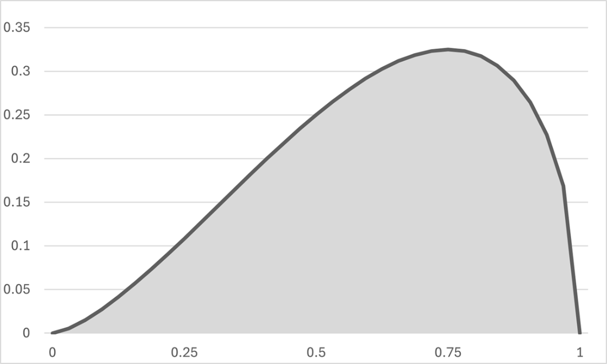
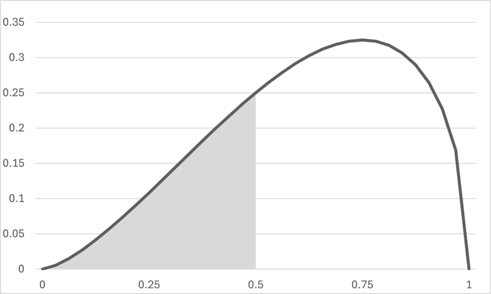
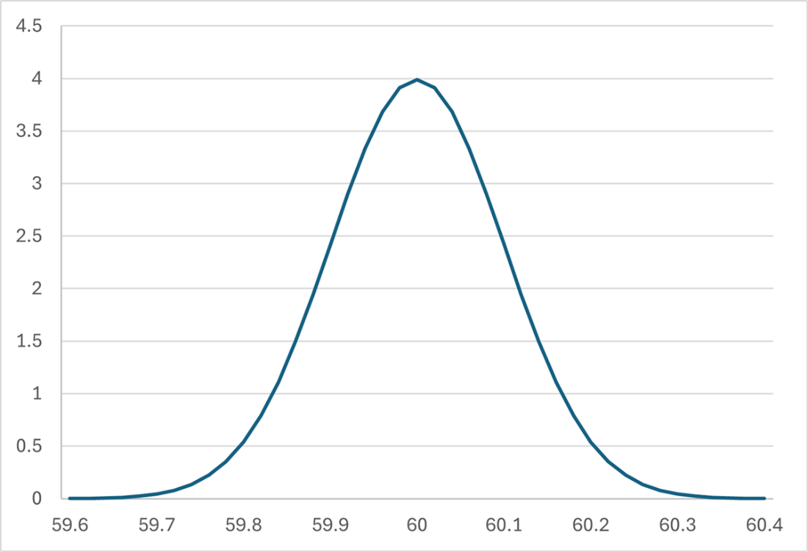
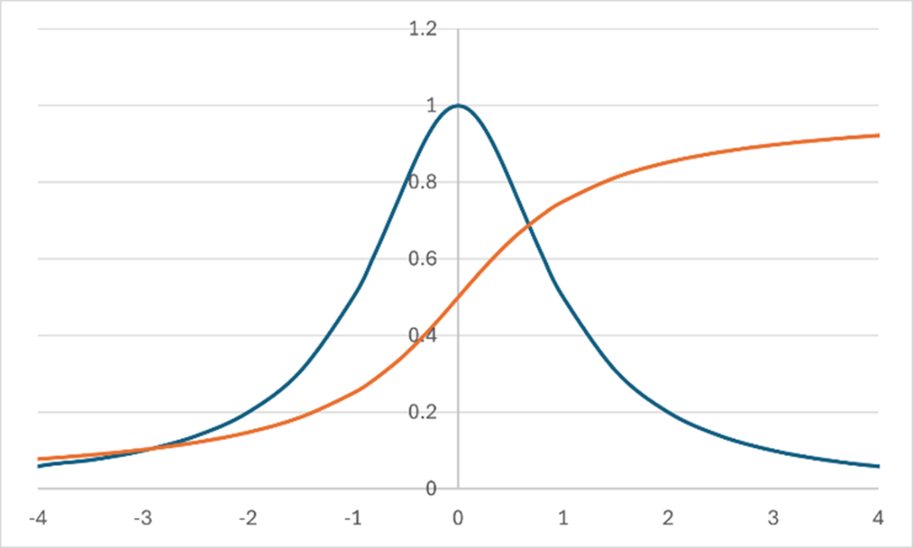
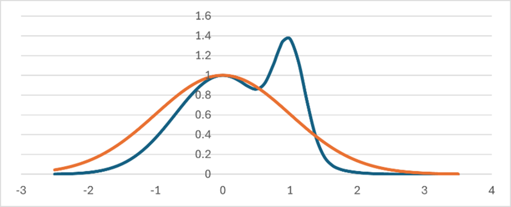
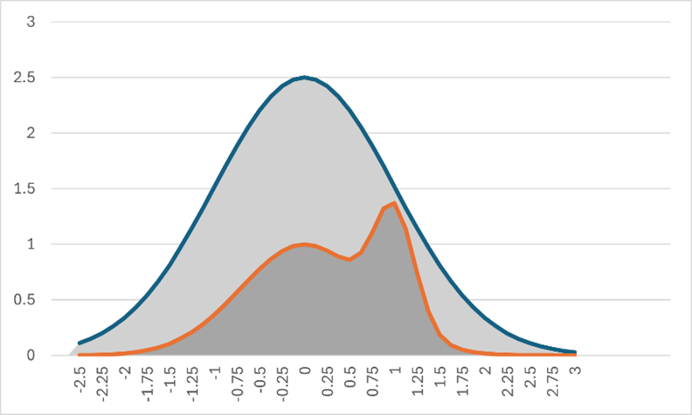

# 连续分布采样

**本章涵盖**

- 均匀分布和正态分布的专用算法
- 逆变换算法
- 拒绝采样算法

我们刚刚已经看到，如何对分类分布完成两件重要的事情：生成符合期望分布的随机样本，以及应用贝叶斯推理来正确解释观察到的证据应如何改变我们的先验信念。在最后两章中，我们将研究一个更难的问题：如何对一维连续分布——实数的随机分布——完成同样的两件事。本章中，我们将研究从特定连续分布中采样的专用技术；在最后一章中，我们将看到如何将贝叶斯定理应用于连续分布。

## 什么是连续概率分布？

对连续分布采样会产生一个随机实数，其支持集是一段连续的可能取值范围。例如，一个制造过程可能会生产出直径存在某种随机变化的圆形零件，而我们会用从某个连续实数范围中抽取的实数来测量其直径。此外，概率本身也是实数；我们经常希望对诸如“一个新用户账户是机器人的概率大约为 90%”这样的随机过程建模，然后在获得有关该用户行为的新证据后更新我们对该概率的看法。

模拟通常需要从连续分布中采样，因此我们将研究几种实现方法。但首先，我们需要一种方法来描述会产生实数的随机过程。我们可以用**概率密度函数（PDF）**来刻画连续分布：这类函数接受一个实数并返回一个非负实数。下面是一个 PDF 示例，它在 0.0 和 1.0 之间非零，在其他任何地方都为零：

```csharp
double P(double x) =>
	0.0 <= x && x <= 1.0 ?
		Math.Pow(x, 0.5) * Math.Pow(1.0 - x, 1.5) :
		0.0;
```

对于 x 位于 0.0 和 1.0 之间，PDF 形式为 P(x) = xa(1-x)b 的分布称为 beta 分布；它们经常出现在必须随机生成概率的模型中。图 15.1 展示了这个 PDF 的图像。从连续分布中采样就像投掷一支飞镖，它等概率地落在阴影区域内的任意位置；该点的 x 坐标就是样本：



图 15.1 概率分布函数类似于概率质量函数，但它定义在一段实数范围上，而不是离散项上。要进行采样，就在阴影区域内均匀选择一个点；该点的 x 坐标就是样本值。

样本落在某个特定范围内的概率等于该范围的面积除以总面积。例如，样本小于 0.5 的概率等于图 15.2 中的阴影面积除以曲线下的总面积：



图 15.2 从该分布中抽取的样本小于 0.5 的概率与阴影面积成正比，并且等于本图中的阴影面积除以前一幅图中的阴影面积。

图 15.1 中的总阴影面积看起来大约为 0.2，而图 15.2 中的阴影面积是一个面积约为 0.06 的三角形。用较小的面积除以较大的面积，我们得到样本小于 0.5 的概率大约为 32%。计算生成小于给定值的样本的概率具有根本重要性，本章稍后在研究生成样本的逆变换方法时，我们还会回到这一点。

注意 如果 PDF 下方的总面积恰好为 1.0，那么该 PDF 被称为已归一化。如果你知道你的 PDF 已经归一化，那么就可以跳过除以总面积这一步，因为那只是除以 1.0。正如我们将在最后两章中看到的，在实践中我们经常会处理非归一化的 PDF。

PDF 的一个良好性质是，我们可以快速计算样本接近某个“目标”值的概率。如果我们的目标值是 s，而 e 是某个非常小的正数，那么样本位于 s 和 s+e 之间的概率近似为 P(s)*e/a。也就是说：宽度为 e、高度为 P(s) 的细长矩形的面积除以总面积。

本章我们将探讨的问题是：如何从给定的连续分布中生成样本？这将允许我们模拟具有连续输出的随机过程，例如制造过程。

我们将研究三种方法：针对**特定分布的专用算法**、**逆变换算法**和**拒绝采样算法**。在下一章中，我们将研究第四种方法——**Metropolis 算法**，它将允许我们从后验分布中采样。我们将从最简单的连续分布开始：连续均匀分布：

## 对连续均匀分布进行采样

连续均匀分布会生成某个最小值与最大值之间的一个 double，其中该范围内的任何值出现的可能性都相同。如果最小值和最大值分别是 0.0 和 1.0，那就称为标准分布。我们只需围绕 Random 类中已经实现的伪随机功能做一个小包装，就像我们在第 12 章中为离散均匀分布所做的那样。但首先，我们应该为连续分布定义一个接口。

能够产生任意实数的连续分布没有可以枚举的支持集——试图列出所有 double 是毫无意义的——而且 PDF 是产生正实数而非整数的权重函数。我们需要一些不同的接口。我将定义一个用于 double 加权分布的接口；连续分布是 double 的加权分布，其中权重函数是一个（可能未归一化的）PDF：

清单 15.1 标准连续均匀分布

```csharp
public interface IWeightedDistribution<T> : IDistribution<T>
{
	double Weight(T value);
}
public interface IContinuousDistribution : IWeightedDistribution<double>
{ }
public sealed class ContinuousUniform : IContinuousDistribution
{
    private readonly double min;
    private readonly double max;
    private readonly Random rnd = new();
    public static readonly ContinuousUniform Standard = new(0.0, 1.0);
    public static ContinuousUniform Distribution(double min, double max) =>
    	new(min, max);
    private ContinuousUniform(double min, double max)
    {
        if (min >= max)
        	throw new ArgumentException();
        this.min = min;
        this.max = max;
    }
    public double Weight(double x) =>
    	min <= x && x <= max ? 1.0 : 0.0;
    public double Sample() => rnd.NextDouble() * (max - min) + min;
}
```

这个分布的 PDF 是这样一个函数：在最小值和最大值之间为 1.0，在其他所有地方为 0.0。

能够显示连续分布的直方图很方便。我们之前绘制离散分布的直方图时，为了简单起见将条形格式化为水平方向，但对于连续分布，将条形垂直排列会让直方图看起来像 PDF。清单 15.2 展示了一个从任意 double 序列绘制直方图的算法。我们把直方图给定的低边界和高边界之间的每个样本关联到 40 列中的一列，并首先统计每列中的样本数量。然后我们可以把每一列显示为由零到二十个星号组成的堆叠：

清单 15.2 连续分布的垂直直方图

```csharp
static class Extensions
{
    public static string Histogram(
    	this IContinuousDistribution d, double low, double high) =>
    		d.Samples().Take(100000).Histogram(low, high);
    public static string Histogram(
    	this IEnumerable<double> d, double low, double high)
    {
        const int width = 40;
        const int height = 20;
        int[] columns = new int[width];
        foreach (double sample in d)
        {
            int column = (int)(width * (sample - low) /(high - low));
            if (0 <= column && column < width)
            columns[column] += 1;
        }
        int max = columns.Max();
        double scale = max < height ? 1.0 : ((double)height) / max;
        var sb = new StringBuilder();
        for (int row = height - 1; row >= 0; row -= 1)
        {
            foreach (var b in columns)
            sb.Append(b * scale > row ? '*' : ' ');
            sb.AppendLine();
        }
        return sb.ToString();
    }
}
```

现在我们可以绘制连续均匀分布：

```csharp
Console.WriteLine(ContinuousUniform. Standard.Histogram (0.0, 1.0));
```

……并看到样本确实在整个范围内均匀分布；顶部并不是一条完全笔直的线，存在一些偏差，因为这是由真实的随机样本得到的，但平均而言，每一列中的项目数量都接近相同。

```
** ** *   * *   * * * *    ** *** * * *
************************* **************
****************************************
****************************************
****************************************
****************************************
****************************************
****************************************
****************************************
****************************************
****************************************
****************************************
****************************************
****************************************
****************************************
****************************************
****************************************
****************************************
****************************************
****************************************
```

既然我们已经有了连续均匀分布的分布对象，就可以用它来实现其他特定分布。接下来让我们看看正态分布。

## 对正态分布进行采样

正态分布——或称“高斯”分布，以纪念数学家卡尔·弗里德里希·高斯——也许是最著名的连续概率分布，并且在统计学中极其重要。想象一台制造小部件的机器，所有小部件本应都是 60.0mm 宽，其中绝大多数小部件都在 59.6mm 到 60.4mm 之间，并且大部分都接近 60.0 这个均值。

一种具有强对称性、且大多数测量值都非常接近均值的“钟形”分布，在大量场景中都极其常见，这就是它被称为“正态”分布的原因。正态分布由两个参数刻画：均值，即分布中心所在的位置；以及标准差，它衡量分布“分散”得有多开。均值为 60.0、标准差为 0.1 的随机过程的 PDF 如图 15.3 所示：



图 15.3 均值=60.0、标准差=0.1 的正态分布的 PDF。该图显示的是归一化 PDF；曲线下方的面积为 1.0。

PDF 在两个方向上都无限延伸，但左右两侧的“尾部”极其“细”；距离均值超过四个标准差的样本概率低到几乎可以忽略不计。均值为 0.0、标准差为 1.0 的正态分布称为标准正态分布。标准正态分布的（未归一化）PDF 是：

```csharp
static double StandardWeight(double x) => Exp(-x * x / 2.0);
```

要从标准正态分布中采样，我们可以使用 Box-Muller 变换算法。证明它为何有效会偏离主题太远，但基本思想是：我们使用标准均匀分布生成一个随机半径和一个以弧度表示的随机角度，从而在极坐标中生成一个随机点；这个点在笛卡尔坐标中的 x 坐标服从正态分布。要从任意正态分布中采样，我们可以从标准分布中采样，然后使用标准差和均值对样本进行重新缩放和平移，以匹配所需的分布：

清单 15.3 实现正态分布

```csharp
public sealed class Normal : IContinuousDistribution
{
    private double mean;
    private double stddev;
    public readonly static Normal Standard = Distribution(0, 1);
    public static Normal Distribution(double mean, double stddev) =>
    	new Normal(mean, stddev);
    private Normal(double mean, double stddev)
    {
        this.mean = mean;
        this.stddev = stddev;
    }
    private static double StandardSample()
    {
        var radius = Sqrt(-2.0 * Log(ContinuousUniform.Standard.Sample()));
        var angle = ContinuousUniform.Distribution(0, 2 * PI).Sample(); #A
        return radius * Cos(angle); #B
    }
    private static double StandardWeight(double x) => Exp(-x * x / 2.0);
    public double Sample() => stddev * StandardSample() + mean;
    public double Weight(double x) => StandardWeight((x - mean) / stddev);
}
```

\#A 在极坐标中生成一个随机点
\#B 它的 x 坐标服从正态分布

现在我们可以生成符合前面示例中分布的样本，其中零件尺寸均值为 60.0mm，标准差为 0.1mm：

```csharp
Console.WriteLine(Normal.Distribution(60.0, 0.1).Histogram(59.6, 60.4));
```

……于是我们得到一个钟形直方图；主钟形左右两侧的低高度区域就是尾部。尾部在距离均值超过四个标准差后会变得极其细，因此我只会显示 59.6 到 60.4 之间的直方图部分：

```
****
                 *****
                 ******
                 ******
                ********
                ********
               **********
               **********
              ***********
              ************
              ************
             **************
             **************
            ****************
            ****************
           ******************
          ********************
         **********************
        ************************
****************************************
```

Box-Muller 方法是一种高效生成样本的方法，但它专门适用于正态分布。如果我们想从任何其他特定的、已知的分布中生成样本，该怎么办？如果我们事先知道想要从哪个分布中采样，就可以通过使用逆变换方法来解决这个一般问题。接下来让我们看看它。

## 逆变换法

在第 12 章中，我们为离散分布实现了一个“爬梯子”算法，通过它把来自离散均匀分布的样本转换成来自任意类别分布的样本；逆变换法就是连续分布中的类似算法。它允许我们通过转换来自标准连续均匀分布的样本，从任意连续分布中采样：

从目标分布的归一化 PDF 开始——也就是说，该函数的总面积为 1.0，并描述样本的相对密度。

对 PDF 积分得到累积分布函数（CDF）。CDF 是这样一个函数：它接收一个数，并返回样本小于或等于该数的概率。CDF 在实数轴左侧总是趋近于 0.0，在右侧趋近于 1.0；它们永远不会下降。

**CDF 的反函数称为分位数函数**。也就是说，如果 F(x) 是一个 CDF，而 Q(p) 是它的分位数函数，那么 Q(F(x)) = x。F 接收一个数并返回一个概率；Q 接收一个概率并返回一个数。

使用标准均匀分布生成一个随机概率，并用它调用分位数函数。结果就是来自目标分布的一个样本。

通过用分布的 CDF 的反函数转换一个均匀样本，可以从任意分布中生成样本；这就是它被称为逆变换法的原因。我们可以创建一个小类，在给定一个 PDF 及其对应的分位数函数时返回一个分布对象：

清单 15.4 实现逆变换法

```csharp
public class FromQuantile : IContinuousDistribution
{
    Func<double, double> pdf;
    Func<double, double> quantile;
    public FromQuantile(
        Func<double, double> pdf, Func<double, double> quantile)
    {
        this.pdf = pdf;
        this.quantile = quantile;
    }
    public double Sample() =>
        quantile(ContinuousUniform.Standard.Sample());
    public double Weight(double x) => pdf(x);
}
```

柯西分布——以纪念法国数学家而命名——是一个很好的例子。它是一条钟形曲线，在统计学和物理学中有许多应用；它的尾部比正态分布“肥”得多。柯西分布的归一化 PDF 是

```csharp
static double PDF(double x) => 1.0 / (PI * (1.0 + x * x));
```

CDF 是给出样本小于或等于 X 的概率的函数。对 PDF 积分得到 CDF：

```csharp
static double CDF(double x) => Atan(x)/ PI + 0.5;
```

图 15.4 展示了这两个函数；你可以看到，与图 15.3 中的正态分布相比，该分布的尾部要“肥”得多：



图 15.4 标准柯西分布的归一化 PDF 和 CDF。当尾部样本比任何正态分布中所得到的都更常见时，这个分布很有用。几乎所有 CDF 都具有一种“拉伸的 S”形状，称为“sigmoid”。

分位数函数是 CDF 的反函数：

```csharp
static double Quantile(double p) => Tan(PI * (p - 0.5));
```

我们已经具备了实现该分布所需的一切，只需几行代码：

清单 15.5 根据分位数函数实现标准柯西分布

```csharp
public sealed class Cauchy : FromQuantile
{
    static double PDF(double x) => 1.0 / (1.0 + x * x);
    static double Quantile(double p) => Tan(PI * (p - 0.5));
    public readonly static Cauchy Standard = new();
    private Cauchy() : base(PDF, Quantile) { }
}
```

直方图显示，我们已经成功实现了一个厚尾分布：

```csharp
Console.WriteLine(Cauchy.Standard.Histogram(-4.0, 4.0));
                   **
                  ****
                  ****
                  ****
                 ******
                 ******
                ********
                ********
               *********
               **********
               ***********
              ************
             **************
            ****************
           *****************
          ********************
        ************************
    *******************************
****************************************
****************************************
```

统计学家很早以前就已经推导出了大量有用分布的 PDF、CDF 和分位数函数；我们可以编写简洁的代码来表示这些分布，并高效地从中采样。

遗憾的是，我们并不总是事先确切知道正在从哪个分布中采样；有时我们能够以数值方式计算一个未归一化的 PDF，但不知道它究竟是哪种已有分布——如果确实存在的话。我们将以拒绝采样算法作为本章的收尾，而在下一章中，我们会研究一种用于对后验分布采样的更强大技术：Metropolis 算法。

## 拒绝采样

在第 12 章中，我们为类别分布实现了一个拒绝采样算法：我们通过向一个标有潜在样本值的矩形飞镖靶“投掷飞镖”来生成样本，并拒绝任何没有击中样本的飞镖。拒绝的比例可以任意高，因此该算法的性能可能非常差；别名算法对于离散分布来说是一个好得多的算法。只要我们具备以下三样东西，就可以调整拒绝采样算法，使其能够从目标连续分布中采样：

- 一个计算目标分布未归一化 PDF 的函数。我们不需要确切知道该函数做了什么；我们只需要调用它。
- 一个我们已经知道如何采样的辅助分布，其支持集与目标分布相同或更大。
- 一个缩放因子——一个数，我们可以将辅助分布的未归一化 PDF 乘以它，使得结果始终大于目标分布的未归一化 PDF。

让我们看一个例子，然后再编写代码。下面是一个我们想从中采样的分布的未归一化 PDF：

```csharp
double Target(double x) =>
	Exp(-x * x) + Exp((1.0 - x) * (x - 1.0) * 10.0);
```

> 注意 这个 PDF 是两个正态分布的未归一化 PDF 之和。不过为了这个练习，假设我们不知道任何用于从具有这个 PDF 的分布中采样的特殊技术。

我们知道如何采样的是标准正态分布；本章前面已经写过相关代码。我们可以把它用作辅助分布。图 15.5 展示了目标 PDF 和辅助分布的未归一化权重函数的图形：



图 15.5 双峰函数是目标分布的 PDF，单峰函数是本章前面提到的未归一化标准正态分布，我们将把它用作辅助分布。显然，辅助分布的 PDF 并不是在所有地方都大于目标分布的 PDF，但我们可以修正这一点。

如果我们将辅助 PDF 乘以 2.5 的缩放因子，得到的仍然是同一个标准正态分布；我们改变的只是曲线下方的总面积。图 15.6 展示了缩放后的辅助权重函数和目标函数：



图 15.6 目标 PDF 始终小于放大后的辅助 PDF，因此我们可以进行拒绝采样。如果我们“投掷飞镖”，并且它落在深灰色区域，那么飞镖的 x 坐标就是样本。如果它落在浅灰色区域，我们就拒绝它并重试。

现在我们要做的就是编写“投掷飞镖”的代码。飞镖的 x 坐标是来自辅助分布的一个样本，而 y 坐标是在 0.0 到缩放后的辅助函数之间均匀选择的一个高度。如果得到的点位于目标 PDF 下方，那么 x 坐标就是一个有效样本。否则，我们拒绝它并重试：

清单 15.6 实现拒绝采样算法

```csharp
public sealed record class Rejection(
    Func<double, double> Target,
    IContinuousDistribution Helper,
    double Scale
    ) : IContinuousDistribution
{
    public double Weight(double x) => Target(x);
    public double Sample()
    {
        while(true)
        {
            double x = Helper.Sample();
            double weight = Weight(x);
            if (weight == 0.0)
                continue;
            double max = Helper.Weight(x) * Scale;  #A
            double y = ContinuousUniform.Distribution(0.0, max).Sample();
            if (y <= weight)
                return x;        
        }
    }
}
```

\#A 如果我们选择了一个不在目标分布支持集中的值，就可以立即拒绝它

让我们用正态分布混合的例子试一下：

```csharp
var target = (double x) =>
    Exp(-x * x) + Exp((1.0 - x) * (x - 1.0) * 10.0);
var mixture = new Rejection(target, Normal.Standard, 2.5);
Console.WriteLine(mixture.Histogram(-2.0, 3.0));
```

得到的直方图看起来像目标 PDF：

```
*
                      ***
                      ***
                      ***
                      ***
              ****   ****
             ******  *****
             *************
            **************
           ***************
          ****************
          *****************
         ******************
        *******************
        *******************
       *********************
      **********************
     ***********************
   ***************************
```

让我们快速看一下如何使用拒绝采样将一个已有分布“钳制”到某个范围。之后，我们将讨论拒绝采样算法的一些困难。

### 使用拒绝采样进行钳制

正态分布（以及许多其他有用的分布）都有很长、很细的尾部，在这些尾部中样本不太可能出现，但并非不可能出现。通常，将一个分布的支持集“钳制”起来以完全排除尾部会很方便，而拒绝采样正是实现这一点的好方法：我们从“未钳制”的分布中采样，并拒绝位于钳制范围之外的样本：

清单 15.7 通过拒绝采样进行钳制

```csharp
public static IContinuousDistribution Clamp(
        this IContinuousDistribution original, double min, double max) =>
        new Rejection(
            (double d) => min <= d && d <= max ? original.Weight(d) : 0.0,
            original,
            1.0);
```

例如，假设有一家工厂生产糟糕的汽车，每辆车在一年内发生故障的概率都是随机的，且故障概率服从以 50% 为中心的正态分布。正态分布的尾部没有任何意义——不存在故障概率为 110% 或 -50% 的汽车，因此消除这些尾部是合理的：

```csharp
var original = Normal.Distribution(0.5, 0.2);
var clamped = original.Clamp(0.0, 1.0);
Console.WriteLine(original.Histogram(-0.5, 1.5));
Console.WriteLine(clamped.Histogram(-0.5, 1.5));
```

原始分布有很长的尾部：

```
**
                  ****
                  ****
                 ******
                 ******
                 ******
                ********
                ********
                ********
               **********
               **********
              ***********
              ************
              ************
             **************
             **************
            ****************
           ******************
          ********************
   ***********************************
```

但钳制后的分布没有：

```
***
                  ****
                  ****
                 ******
                 ******
                 ******
                ********
                ********
                ********
               **********
               **********
              ***********
              ************
              ************
             **************
             **************
            ****************
           ******************
          ********************
          ********************
```

通过钳制来消除支持集中的低概率区域或不可能区域，是拒绝采样的理想用途：辅助分布就是原始分布，目标权重函数很容易计算，缩放因子为 1.0。这与我们前一个使用拒绝采样从双峰分布中采样的例子形成了鲜明对比。在下一章中，当我们研究如何从后验分布中采样时，会看到一个使用钳制分布的例子。

### 拒绝采样的问题

拒绝采样有两个大问题。首先，在得到一个样本之前，被拒绝的次数可能任意大。在双峰例子中，图 15.6 中浅灰色的“拒绝”区域大致与深灰色的“接受”区域一样大；我们拒绝的频率会和接受一样高。在获得一个样本之前，你可能循环多少次是没有上限的。

其次，并不存在一种通用方法，能够自动找出对给定未归一化 PDF 有效的辅助分布和缩放因子。我选择了一个目标分布，在电子表格中将它与标准正态分布一起绘图，然后尝试不同的缩放因子，直到找到一个既可行又不会产生太多“拒绝”区域的因子；我本来也可以改变均值和标准差，以找到一个拟合更好的辅助分布并使用更小的缩放因子。如果目标分布有更肥的尾部，那么我就需要使用柯西分布作为辅助分布。拟合一个好的辅助分布通常需要专家手动完成。我们希望能够自动地从任意分布中采样，而不仅仅是从精心构造的例子中采样。

此外，我们仍然还没有看到如何将贝叶斯定理应用到连续分布。我们应该能够创建一个统计模型，描述我们对某个连续现象的信念，观察证据，然后以有原则的方式更新这些信念。在下一章中，我们将看到如何从任意连续分布中采样，包括后验分布。

## 小结

- 连续概率分布可以由其概率密度函数（PDF）来刻画。从一个分布中采样，就像是均匀地向 PDF 下方的区域投掷飞镖，并使用其 x 坐标作为样本。如果 PDF 下方的面积为 1.0，就称其为“归一化”的；我们经常会遇到未归一化的 PDF。
- 连续均匀分布会在给定范围内生成等可能的随机样本；如果范围是 0.0 到 1.0，那就是标准均匀分布。
- 正态分布描述的是这样一种随机过程：围绕某个中心值，即均值，存在一定偏差；这就是经典的“钟形”曲线。
- PDF 的积分是累积分布函数（CDF）。这个函数给出样本小于某个给定值的概率。
- CDF 的反函数是分位数函数。如果我们知道一个分布的分位数函数，就可以从该分布中采样：用一个标准均匀样本调用分位数函数，会生成一个来自目标分布的样本。
- 如果我们不知道分位数函数，但拥有目标分布的 PDF，那么有时可以找到一个辅助分布，使我们能够使用拒绝采样算法。寻找合适的辅助分布并不容易自动化，并且在一个样本被接受之前，可能会有任意多的样本被拒绝。
- 在最后一章中，我们将使用 Metropolis 算法从任意连续分布中采样，包括连续后验分布。这将使我们能够在程序中自动化决策时使用有原则的贝叶斯推理。